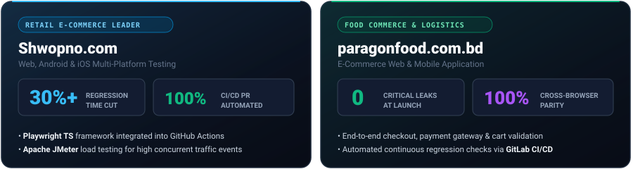
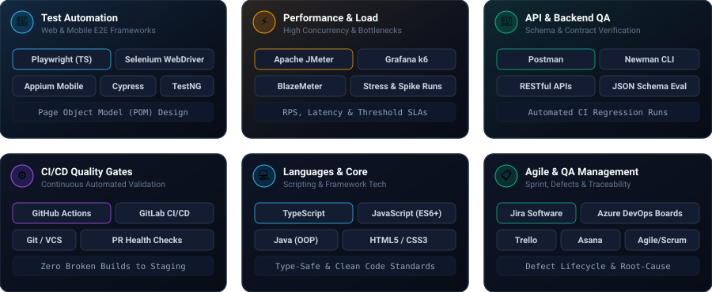
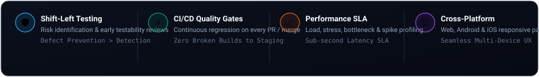

  <!-- Dynamic Custom Animated Header -->
  

  <!-- Animated Typing Headline -->
  

 

<!-- ========================================================================= -->
<!-- 💻 SQA CORE ARCHITECTURE & TERMINAL PROFILE -->
<!-- ========================================================================= -->

  

 

<!-- ========================================================================= -->
<!-- 🏆 ENTERPRISE SCALE & BUSINESS IMPACT -->
<!-- ========================================================================= -->
### 🏆 Enterprise QA Impact & Production Scale

  

 

<!-- ========================================================================= -->
<!-- 🛠️ TECHNICAL ARSENAL & TOOLING BENTO GRID -->
<!-- ========================================================================= -->
### 🛠️ Technical Stack & Tooling

  

 

<!-- ========================================================================= -->
<!-- 🛡️ QUALITY ENGINEERING PHILOSOPHY -->
<!-- ========================================================================= -->
### 🛡️ Core Engineering Philosophy

  

 

<!-- ========================================================================= -->
<!-- 📊 GITHUB ACTIVITY & METRICS -->
<!-- ========================================================================= -->
### 📊 GitHub Activity & Analytics

<!-- 3D Contribution Graph -->

  

 

<!-- Parallel Streak & Stats in TokyoNight -->

  
  

<!-- Top Languages Chart -->

  

 

<!-- ========================================================================= -->
<!-- 📌 FEATURED AUTOMATION & TESTING REPOSITORIES -->
<!-- ========================================================================= -->
### 📌 Starred QA Suites & Frameworks

<table>
  <tr>
    <td width="50%">
      <h4>⚡ <a href="https://github.com/Shazzad01/performance_testing_k6">performance_testing_k6</a></h4>
      
Modern performance, stress, and spike test scripts written in <strong>k6</strong>, measuring latency, requests per second (RPS), and threshold SLA limits.

      
    </td>
    <td width="50%">
      <h4>📱 <a href="https://github.com/Shazzad01/AndroideappTestting">AndroideappTestting</a></h4>
      
Mobile test automation framework for Android e-commerce demo applications using <strong>Appium</strong> and <strong>Java</strong>.

      
    </td>
  </tr>
  <tr>
    <td width="50%">
      <h4>🌐 <a href="https://github.com/Shazzad01/POM_Selenium">POM_Selenium</a></h4>
      
Production-ready Page Object Model (POM) test architecture built in <strong>Java + Selenium</strong> with clean page separation and robust locators.

      
    </td>
    <td width="50%">
      <h4>🔌 <a href="https://github.com/Shazzad01/Student-Rest-API-Newman">Student-Rest-API-Newman</a></h4>
      
Automated RESTful API regression collection with automated assertions, continuous execution via <strong>Newman CLI</strong>, and HTML test summaries.

      
    </td>
  </tr>
</table>

 

<!-- ========================================================================= -->
<!-- 🎓 EDUCATION & CREDENTIALS -->
<!-- ========================================================================= -->
### 🎓 Education & Professional Certifications

* 🎓 **Bachelor of Science (B.Sc.) in Computer Science & Engineering (CSE)**  
  * **Daffodil International University** | **CGPA: 3.59 / 4.00** *(Graduated: March 2023)*
* 📜 **Professional Software Quality Assurance Program (Batch 16)**  
  * **IT Training BD, Dhaka** *(2023)* — Core test planning, automated frameworks (Playwright, Selenium), and API verification.

 

<!-- ========================================================================= -->
<!-- 📫 CONNECT & COLLABORATE -->
<!-- ========================================================================= -->
### 📫 Connect & Collaborate

  
  &nbsp;&nbsp;
  
  &nbsp;&nbsp;
  

<!-- Dynamic Footer Wave -->

  

