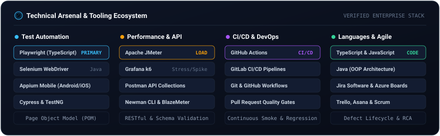

  <!-- Minimalist Animated Vector Header -->
  

 

### 👨‍💻 About Me

I am an **SQA Engineer II** at **Brain Station 23 PLC** with **2+ years of enterprise experience** in software quality assurance across web, Android, and iOS ecosystems. I focus on automated end-to-end testing, high-concurrency load testing, and embedding automated quality gates directly into CI/CD pipelines.

* 🏢 **Current Role:** SQA Engineer II @ Brain Station 23 PLC
* 🎓 **Education:** B.Sc. in Computer Science & Engineering (CSE) — Daffodil International University (CGPA: 3.59 / 4.00)
* 📍 **Location:** Dhaka, Bangladesh
* 📬 **Contact:** [shazzadm065@gmail.com](mailto:shazzadm065@gmail.com) • [LinkedIn](https://www.linkedin.com/in/md-shazzad-mia/)

 

<!-- ========================================================================= -->
<!-- 🛠️ TOOLS & FRAMEWORKS ECOSYSTEM -->
<!-- ========================================================================= -->
### 🛠️ Tools & Frameworks

  

 

<!-- ========================================================================= -->
<!-- 📂 FEATURED TESTING & AUTOMATION REPOSITORIES -->
<!-- ========================================================================= -->
### 📂 Featured Repositories & Testing Suites

<table>
  <tr>
    <td width="50%">
      <h4>⚡ <a href="https://github.com/Shazzad01/performance_testing_k6">performance_testing_k6</a></h4>
      
Performance, stress, and spike test scripts written in <strong>k6</strong>, evaluating latency, RPS throughput, and threshold SLA compliance.

      
    </td>
    <td width="50%">
      <h4>📱 <a href="https://github.com/Shazzad01/AndroideappTestting">AndroideappTestting</a></h4>
      
Mobile test automation suite for Android e-commerce demo applications using <strong>Appium</strong> and <strong>Java</strong>.

      
    </td>
  </tr>
  <tr>
    <td width="50%">
      <h4>🌐 <a href="https://github.com/Shazzad01/POM_Selenium">POM_Selenium</a></h4>
      
Page Object Model (POM) web automation architecture in <strong>Java + Selenium WebDriver</strong> with clean locator separation and TestNG assertions.

      
    </td>
    <td width="50%">
      <h4>🔌 <a href="https://github.com/Shazzad01/Student-Rest-API-Newman">Student-Rest-API-Newman</a></h4>
      
Automated RESTful API regression collection with automated assertions, continuous execution via <strong>Newman CLI</strong>, and HTML test summaries.

      
    </td>
  </tr>
</table>

 

<!-- ========================================================================= -->
<!-- 🎓 EDUCATION & PROFESSIONAL CERTIFICATIONS -->
<!-- ========================================================================= -->
### 🎓 Education & Professional Certifications

* 🎓 **Bachelor of Science in Computer Science & Engineering (B.Sc. in CSE)**  
  * **Daffodil International University** | **CGPA: 3.59 / 4.00** *(Graduated: March 2023)*
* 📜 **Professional Software Quality Assurance Program (Batch 16)**  
  * **IT Training BD, Dhaka** *(2023)* — Test planning, test case design, automation fundamentals (Playwright, Selenium), and API verification.

 

<!-- ========================================================================= -->
<!-- 📫 CONNECT -->
<!-- ========================================================================= -->
### 📫 Connect & Collaborate

  
  &nbsp;&nbsp;
  
  &nbsp;&nbsp;
  

