  <!-- Clean Animated Vector Header -->
  

 

### 👨‍💻 About Me

I am an **SQA Engineer II** at **Brain Station 23 PLC** with **2+ years of professional experience** delivering quality assurance for high-traffic web, Android, and iOS applications. I specialize in building scalable automated regression frameworks (Playwright, Selenium), high-concurrency performance testing (JMeter, k6), and integrating automated quality gates into CI/CD pipelines.

---

### 🛠️ Tools & Frameworks

<table>
  <tbody>
    <tr>
      <td width="200" align="left"><strong>🚀 Test Automation</strong></td>
      <td>
        
        
        
        
        
      </td>
    </tr>
    <tr>
      <td align="left"><strong>⚡ Performance Testing</strong></td>
      <td>
        
        
        
      </td>
    </tr>
    <tr>
      <td align="left"><strong>🔌 API Testing</strong></td>
      <td>
        
        
        
      </td>
    </tr>
    <tr>
      <td align="left"><strong>⚙️ CI/CD & DevOps</strong></td>
      <td>
        
        
        
        
      </td>
    </tr>
    <tr>
      <td align="left"><strong>💻 Languages</strong></td>
      <td>
        
        
        
        
        
      </td>
    </tr>
    <tr>
      <td align="left"><strong>📋 Agile & Management</strong></td>
      <td>
        
        
        
        
      </td>
    </tr>
  </tbody>
</table>

---

### 📂 Featured Repositories

<table>
  <tr>
    <td width="50%">
      <h4>⚡ <a href="https://github.com/Shazzad01/performance_testing_k6">performance_testing_k6</a></h4>
      
Performance, stress, and spike test scripts written in <strong>k6</strong>, evaluating latency, RPS throughput, and threshold SLA compliance.

    </td>
    <td width="50%">
      <h4>📱 <a href="https://github.com/Shazzad01/AndroideappTestting">AndroideappTestting</a></h4>
      
Mobile test automation suite for Android demo applications using <strong>Appium</strong> and <strong>Java</strong>.

    </td>
  </tr>
  <tr>
    <td width="50%">
      <h4>🌐 <a href="https://github.com/Shazzad01/POM_Selenium">POM_Selenium</a></h4>
      
Page Object Model (POM) web automation architecture in <strong>Java + Selenium WebDriver</strong> with clean locator separation and TestNG assertions.

    </td>
    <td width="50%">
      <h4>🔌 <a href="https://github.com/Shazzad01/Student-Rest-API-Newman">Student-Rest-API-Newman</a></h4>
      
API regression test collection with automated assertions, continuous execution via <strong>Newman CLI</strong>, and HTML test summaries.

    </td>
  </tr>
</table>

---

### 🎓 Education & Training

* 🎓 **Bachelor of Science in Computer Science & Engineering (B.Sc. in CSE)**  
  *Daffodil International University* — CGPA: **3.59 / 4.00** *(March 2023)*
* 📜 **Professional Software Quality Assurance Program (Batch 16)**  
  *IT Training BD, Dhaka* *(2023)*

---

### 📫 Connect

  
  &nbsp;&nbsp;
  
  &nbsp;&nbsp;
  

